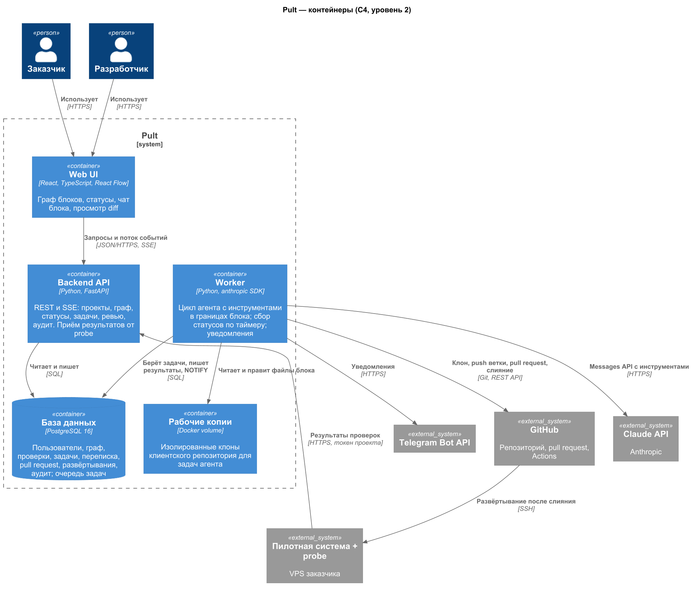

# Pult

Пульт для сопровождения небольших продакшен-систем. Система клиента рисуется графом блоков: сервер, задачи по cron, боты, внешние API, конфиги. У каждого блока свой статус. На блоке можно открыть чат с ИИ-агентом. Агент видит только файлы этого блока, а правки предлагает через pull request, который мержит человек.

Зачем это нужно. Сейчас при сбое клиент пишет разработчику в мессенджер, а тот идёт на сервер и ищет по логам, что сломалось. В Pult сразу видно, какой блок упал, и задачу можно поставить прямо на него.

Для кого: малый бизнес со своей автоматизацией (скрипты, боты, интеграции с учётной системой) и разработчики, которые её поддерживают.

Пилот — автопланирование выпечки для небольшой сети пекарен. Скрипт по cron на VPS берёт продажи из POS-системы, учитывает погоду и праздники, собирает Excel-планы и рассылает их ботом в Telegram. Код пилота лежит в отдельном закрытом репозитории.

## Команда

[@Howksss](https://github.com/Howksss), один на все роли: руководитель, аналитик, архитектор, разработчик, тестировщик и деплой.

Задачи ведутся в [GitHub Issues](https://github.com/Howksss/pult/issues).

## Стек

- backend: Python 3.12, FastAPI, SQLAlchemy 2, Alembic, PostgreSQL 16
- frontend: React 18, TypeScript, Vite, React Flow
- агент: Claude API (`anthropic`, модель `claude-opus-5-5`)
- Docker Compose, GitHub Actions, образы в GHCR
- диаграммы: PlantUML (C4, ER) и BPMN (bpmn.io), ручная проверка API — Bruno

## Как устроено

Модульный монолит. Один и тот же код на FastAPI запускается в двух ролях: `api` (отдаёт UI и принимает статусы от probe) и `worker` (выполняет задачи агента и собирает статусы). Очередь и все данные хранятся в Postgres. Код клиента агент меняет только в отдельной ветке через PR, на сервер изменение попадает через CI/CD после ревью.



## Запуск

```bash
cp .env.example .env

cd backend
python -m venv .venv
.venv/Scripts/activate        # Linux: source .venv/bin/activate
pip install -r requirements-dev.txt
uvicorn app.main:app --reload
curl http://localhost:8000/api/health

cd ../frontend
npm install
npm run dev
```

Всё сразу в контейнерах: `docker compose -f deploy/docker-compose.yml up --build`.

## Тесты и проверки

```bash
pre-commit install              # один раз: хуки на коммит

cd backend
pytest                          # тесты и покрытие, порог 90 %
ruff check . && ruff format --check . && mypy && pylint app

cd ../frontend
npm test                        # vitest и покрытие
npm run lint && npm run format:check
```

Тесты на Postgres (`test_pg_*`) идут, только если задан `TEST_DATABASE_URL`, иначе пропускаются. В CI они идут всегда. В VS Code те же команды есть в задачах (`.vscode/tasks.json`). Все хуки по всем файлам: `pre-commit run --all-files`.

## Документация

- процессы As-Is и To-Be: [описание](docs/bpmn/README.md), [as_is.bpmn](docs/bpmn/as_is.bpmn) / [png](docs/bpmn/as_is.png), [to_be.bpmn](docs/bpmn/to_be.bpmn) / [png](docs/bpmn/to_be.png)
- требования: [функциональные](docs/requirements/functional.md), [нефункциональные](docs/requirements/non_functional.md)
- архитектура: [контекст C4](docs/architecture/context_diagram.puml) / [png](docs/architecture/context_diagram.png), [контейнеры C4](docs/architecture/container_diagram.puml) / [png](docs/architecture/container_diagram.png), [ADR](docs/adr)
- данные: [ER-модель](docs/data/README.md) / [png](docs/data/er_diagram.png), [запросы](docs/data/queries.md), [бэкапы](docs/data/backup.md)
- API: [docs/api](docs/api/README.md)
- ветки, коммиты и PR: [branching.md](docs/process/branching.md), [ретроспектива](docs/process/retrospective.md)
- качество и тесты: [docs/quality](docs/quality/README.md), [модуль 4](docs/module4/README.md)
- интерфейс, low-code, деплой, мониторинг, безопасность: [ui](docs/ui/README.md), [lowcode](docs/lowcode/README.md), [deploy](docs/deploy/README.md), [ops](docs/ops/monitoring.md), [security](docs/security/threat-model.md)

```
backend/     FastAPI, миграции, тесты
frontend/    React-приложение с графом
deploy/      docker compose, бэкапы, смоук-тест
docs/        требования, модели, архитектура, ADR, отчёты
```
