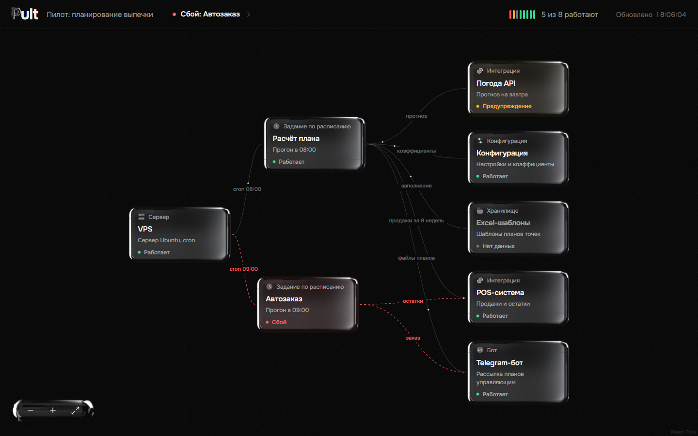
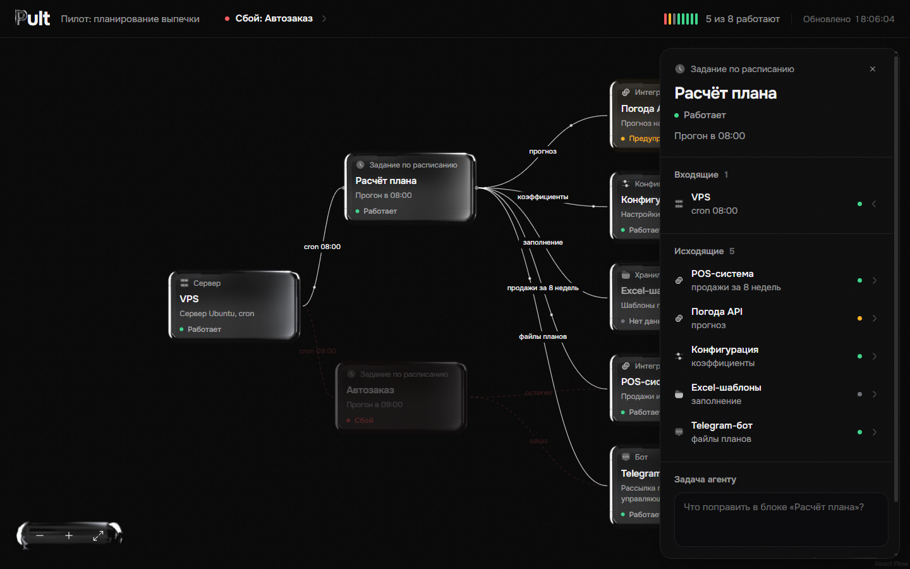

# Интерфейс

## Прототип главного экрана

```
+----------------------------------------------------------------------------------------+
| [P]ult  Пилот: планирование выпечки  * Сбой: Автозаказ >     ||||||| 5 из 8 работают | Обновлено 15:47 |
+----------------------------------------------------------------------------------------+
|                                                               +----------------------+ |
|                 .-------------------.        .------------.   | [i] Задание      [x] | |
|  .----------.   | [i] Задание       |-прогноз->[i] Интегр.|   | Расчёт плана         | |
|  | [i] Сервер|-->| Расчёт плана     |        | Погода API |   | * Работает           | |
|  | VPS      |   | Прогон в 08:00    |        | * Предупр. |   | Входящие 1           | |
|  | * Работает   | * Работает        |~~~~~~~~>'------------'   |  [i] VPS  cron 08:00 | |
|  '----------'   '-------------------'  остатки                 | Исходящие 5          | |
|   (стеклянные плиты)               (красный пунктир)           | Задача агенту        | |
|  ( - + [] )                                                    | [....] (Отправить)   | |
+----------------------------------------------------------------+----------------------+-+
```

| Элемент | Требование | Поведение |
|---|---|---|
| Шапка | FR-10 | Логотип со стеклянной буквой P, название проекта из `project_name`, итог системы одной фразой: «Всё работает», «Сбой: Автозаказ», «Предупреждения в 3 блоках», «Нет данных от проверок». Если есть проблемный блок, итог — кнопка, которая открывает этот блок. Справа по одной риске на блок цветом статуса (проблемные первыми), «5 из 8 работают» и время последнего ответа сервера. Если сервер не отвечает — «Нет связи, данные от …» красным |
| Узел графа | FR-04, FR-10, NFR-U2 | Стеклянная плита: иконка и тип, имя, описание, статус точкой и словом. У сбоя под стеклом тёмно-красная подложка и красное слово, у предупреждения — янтарная. Свечения и цветных рамок нет. У «Нет данных» приглушены имя и иконка |
| Связь | FR-05 | Тонкая серая линия, подпись текстом без рамки. По исправной связи бежит точка от источника к получателю. Связь, у которой хотя бы один конец в сбое, — красный бегущий пунктир: видно, куда расходится сбой |
| Выбор блока | FR-12 | Клик по узлу осветляет его стекло, подсвечивает связи белым и приглушает остальное. Если панель закрывает блок, холст плавно сдвигается. `Esc` или клик по пустому месту снимает выбор |
| Панель блока | FR-12, FR-13 | Панель справа: тип, имя, статус, описание, входящие и исходящие связи со статусом соседа. Клик по связи переводит выбор на соседний блок и центрирует его. Поле задачи агенту и стеклянная кнопка «Отправить» включатся вместе с чатом агента (0.3.0) |
| Причина на блоке | FR-12 | Если блок не в порядке, вместо описания стоит причина по самой тяжёлой проверке: «Автозаказ отработал: Код выхода 1: KeyError: 'store_id'», «Шаблоны открываются: нет отчёта 4 мин». Рядом со статусом — «1 из 3», подсказка расшифровывает: «Проблемы в 1 из 3 проверок» |
| Проверки в панели | FR-12 | Список проверок блока, проблемные первыми и раскрыты. У каждой: имя, тип и цель, когда была и сколько заняла, причина, подробности (код ответа, адрес, код выхода, команда, срок сертификата), вывод stderr, ответ сервера или строки лога. Под ними шкала последних суток: 24 деления, одно деление — час, цвет по худшему результату часа, серый — результатов не было; подписи времени каждые 6 часов и «сейчас», подсказка «07:00: 60 результатов, сбоев 3». Над шкалой «Сбой с 06:10, 1 ч 50 мин», пока серия сбоев не закончилась. Исправные свёрнуты, раскрываются по клику. Обновляется вместе с графом |
| Настройка проверок | FR-07 | «Добавить проверку» открывает форму в панели: тип, название, цель (поле и подсказка меняются по типу), интервал, для внешних — таймаут, для HTTP — текст в ответе, порог медленного ответа и ожидаемые коды, для сертификата — пороги в днях. Ошибка сервера показывается под формой. В раскрытой проверке: «Проверить сейчас» (внешние), «Изменить», «Выключить» или «Включить», «Удалить» с подтверждением; у заданий, heartbeat и логов — готовая строка `pult-run` для cron |
| Область агента | FR-06 | Пути репозитория моноширинным шрифтом и право «чтение» или «запись» списком; право меняется сразу, крестик убирает путь. Строка добавления: путь, право, «Добавить». Ошибки сервера («..» в пути, повтор) — под строкой |
| Перетаскивание | FR-04 | Блок можно перетащить, положение сохраняется `PATCH /api/v1/blocks/{id}`. Опрос сервера во время перетаскивания не сбивает блок. При ошибке сохранения — всплывающее сообщение |
| Обновление | FR-10, NFR-P2 | Граф перезапрашивается каждые 10 с без перезагрузки страницы. Если сервер не ответил, граф остаётся на экране, в шапке «Нет связи» |
| Масштаб | — | Стеклянная пилюля внизу слева: «Отдалить», «Приблизить», «Показать всё» с плавным переходом. Мини-карты нет: на графе в 8–20 блоков она только занимает место |

Для заказчика путь «увидеть сбой → открыть блок → поставить задачу» занимает 2 действия (NFR-U1: не больше 3): клик по итогу в шапке сразу открывает упавший блок.

## Визуальный язык

- **Тема.** Только тёмная: фон `#070707`, зерно поверх всего экрана, токены цветов в `:root` файла `App.css`.
- **Стекло.** Не CSS-эффект, а рендеры Blender: дымчатое бесцветное стекло, отражения панорамы. Плита блока (`public/glass/card.webp`) растягивается через `border-image` с неподвижными углами, пилюля (`pill.webp`) — для кнопок и панели масштаба, буква P — для логотипа. Под стеклом непрозрачная подложка, чтобы сквозь блок не просвечивали связи. Цвет стекла нейтральный: на доске цветом обозначается только статус.
- **Статусы.** Один цвет на статус во всех местах: точка, слово статуса, риска в шапке. Зелёный — работает, янтарный — предупреждение, красный — сбой, серый — нет данных. Цвет всегда дублируется словом (NFR-U2), у слова есть подсказка, что статус значит. «Нет данных» — свежих проверок нет: probe не подключён или давно молчит.
- **Акцент.** Размером и насыщенностью, а не цветом: выбранный блок — светлее стекло, подсвеченные связи — белые.
- **Шрифт.** Onest Variable с кириллицей, подключён пакетом `@fontsource-variable/onest`: шрифт собирается в образ, внешних запросов нет. Текст не мельче 14 px.
- **Иконки.** [Iconsax](https://docs.iconsax.io/license-and-terms/license) из файла Figma Community «7000 FREE UI ICONS», страница Interface icons. Типы блоков — стиль bulk (двухтоновый, вторичные части с прозрачностью 0,4), кнопки и стрелки — linear с линией 1,5. SVG выгружены через Figma REST API и собраны в `components/Icon.tsx`, цвет — `currentColor`, внешней зависимости нет. Лицензия бесплатного набора разрешает коммерческое использование в приложениях и на сайтах без указания автора, перепродавать сами иконки нельзя.
- **Движение.** Бегущие точки, пунктир сбоя и появление панели отключаются при `prefers-reduced-motion: reduce`. Стеклянные кнопки при нажатии проседают и возвращаются пружиной.
- **Узкий экран.** До 1100 px в шапке остаются риски без подписи. До 720 px в шапке только логотип и итог, панель блока становится нижней шторкой.

## Реализация

- `frontend/src/api.ts` — типы ответа `GET /api/v1/projects/{id}/graph` по контракту, загрузка графа и сохранение положения блока.
- `frontend/src/graph.ts` — чистые функции: узлы и связи React Flow, слияние позиций при опросе, соседи и связи блока, счётчики статусов, итог системы для шапки. Покрыты тестами.
- `frontend/src/status.ts` — подписи, подсказки и цвета статусов.
- `frontend/src/components/` — `BlockNode` (узел), `FlowEdge` (связь с подписью и движением), `Inspector` (панель блока), `TopBar` (шапка), `StatusBadge` и `StatusDot` (статус), `KindIcon` (иконка типа), `Icon` (все иконки интерфейса).
- `frontend/public/glass/` — рендеры стекла: плита блока, пилюля, буква логотипа (1x и 2x).
- `frontend/src/App.tsx` — экран: опрос сервера, холст React Flow, выбор, перетаскивание.

Граф пилотного проекта:



Выбран блок «Расчёт плана»: связи подсвечены, открыта панель блока:



Запуск: `uvicorn app.main:app` в `backend` и `npm run dev` в `frontend`, затем открыть `http://localhost:5173/?project=1`.
