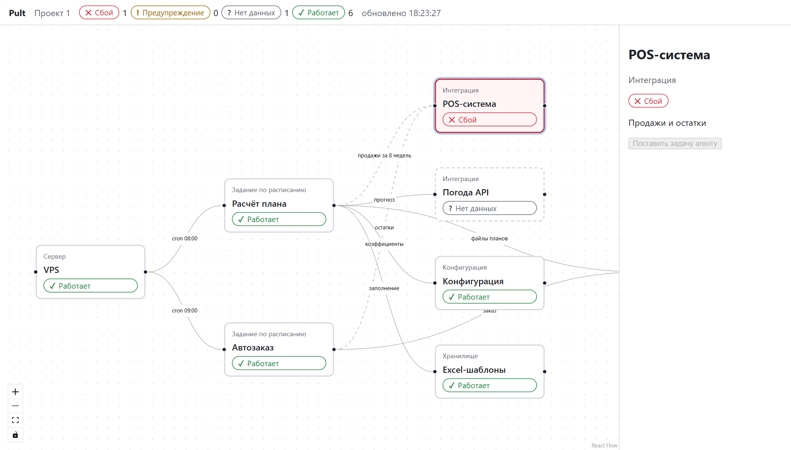

# Интерфейс

## Прототип главного экрана

```
+--------------------------------------------------------------------------------+
| Pult   Проект 1   [x Сбой] 1  [! Предупреждение] 0  [? Нет данных] 1  [v Работает] 6   обновлено 18:22 |
+-------------------------------------------------------------+------------------+
|                                                             | POS-система      |
|   +---------+     +--------------+     +--------------+     | Интеграция       |
|   | Сервер  |---->| Задание      |---->| Интеграция   |     | [x Сбой]         |
|   | VPS     |     | Расчёт плана |     | POS-система  |     | Продажи и остатки|
|   | [v ...] |     | [v Работает] |     | [x Сбой]     |     |                  |
|   +---------+     +--------------+     +--------------+     | [Поставить задачу|
|                         |              +--------------+     |  агенту]         |
|                         +------------->| Погода API   |     |                  |
|                                        | [? Нет данных|     |                  |
|  [+][-][[]]                            +--------------+     |                  |
+-------------------------------------------------------------+------------------+
```

| Элемент | Требование | Поведение |
|---|---|---|
| Сводка в шапке | FR-10 | Число блоков по статусам, время последнего обновления |
| Узел графа | FR-04, FR-10, NFR-U2 | Тип и имя блока, статус цветом рамки, иконкой и подписью. Сбой — красная рамка и фон, нет данных — пунктир |
| Связь | FR-05 | Подпись связи. Связь, ведущая в упавший блок, анимирована: видно, откуда пойдёт сбой |
| Карточка блока | FR-12, FR-13 | Открывается по клику на узел: тип, статус, описание. Кнопка задачи агенту будет активна с появлением чата агента |
| Обновление | FR-10, NFR-P2 | Граф перезапрашивается каждые 10 с без перезагрузки страницы |

Для заказчика путь «увидеть сбой → открыть блок → поставить задачу» занимает 2 действия (NFR-U1: не больше 3).

## Реализация

- `frontend/src/api.ts` — типы ответа `GET /api/v1/projects/{id}/graph` по контракту и загрузка графа.
- `frontend/src/graph.ts` — преобразование графа API в узлы и связи React Flow (чистая функция, покрыта тестами).
- `frontend/src/components/BlockNode.tsx` — узел блока, `StatusBadge.tsx` — статус.
- `frontend/src/App.tsx` — экран: шапка, холст React Flow, карточка блока.



Запуск: `uvicorn app.main:app` в `backend` и `npm run dev` в `frontend`, затем открыть `http://localhost:5173/?project=1`.
