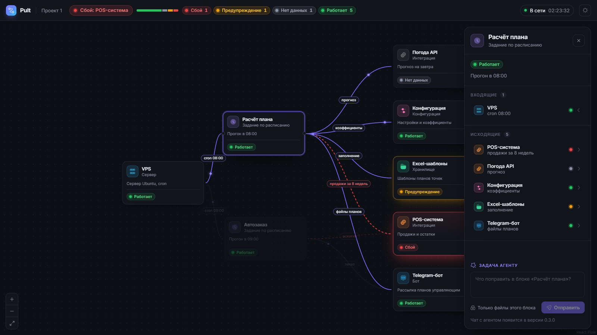
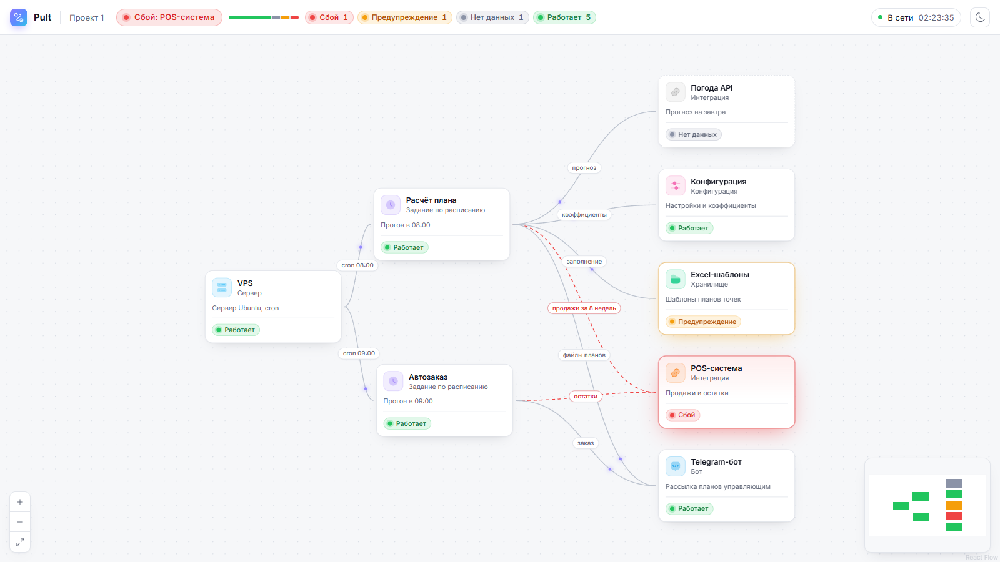

# Интерфейс

## Прототип главного экрана

```
+----------------------------------------------------------------------------------------+
| [P] Pult | Проект 1  (* Сбой: POS-система) [=====--] (* Сбой 1) (* Предупр. 1) (* Работает 5)  * В сети [тема] |
+----------------------------------------------------------------------------------------+
|                                                               +----------------------+ |
|                 .-------------------.        .------------.   | [i] Расчёт плана  [x]| |
|  .----------.   | [i] Расчёт плана  |-прогноз->[i] Погода |   |     Задание          | |
|  | [i] VPS  |-->| Прогон в 08:00    |        | (* Нет данных)  | (* Работает)         | |
|  | (* ...)  |   | (* Работает)      |~~~~~~~~>.------------.   | ВХОДЯЩИЕ 1           | |
|  '----------'   '-------------------'  продажи| [i] POS    |   |  [i] VPS  cron 08:00 | |
|                                    (пунктир)  | (* Сбой)   |   | ИСХОДЯЩИЕ 5          | |
|                                               '------------'   |  [i] POS  продажи    | |
|                                                                | ЗАДАЧА АГЕНТУ        | |
|  [+][-][[]]                                  [мини-карта]      | [....] [Отправить]   | |
+----------------------------------------------------------------+----------------------+-+
```

| Элемент | Требование | Поведение |
|---|---|---|
| Шапка | FR-10 | Итог системы одной фразой: «Всё работает», «Сбой: POS-система», «Предупреждения в 3 блоках», «Нет данных от проверок». Если есть проблемный блок, итог — кнопка, которая открывает этот блок. Дальше полоса здоровья, счётчики только ненулевых статусов, индикатор «В сети» или «Нет связи» и время ответа сервера, переключатель темы |
| Узел графа | FR-04, FR-10, NFR-U2 | Иконка типа на цветной плашке, имя, тип, описание, статус цветной точкой и словом. Сбой — красная рамка, свечение и пульсирующая точка, предупреждение — янтарная рамка, нет данных — пунктир и серая точка |
| Связь | FR-05 | Подпись плашкой. По исправной связи бежит точка от источника к получателю. Связь, у которой хотя бы один конец в сбое, — красный бегущий пунктир: видно, куда расходится сбой |
| Выбор блока | FR-12 | Клик по узлу подсвечивает его связи и соседей, остальное приглушается. Если панель закрывает блок, холст плавно сдвигается. `Esc` или клик по пустому месту снимает выбор |
| Панель блока | FR-12, FR-13 | Плавающая панель справа: тип, статус, описание, входящие и исходящие связи со статусом соседа. Клик по связи переводит выбор на соседний блок и центрирует его. Поле задачи агенту и кнопка «Отправить» включатся вместе с чатом агента (0.3.0) |
| Перетаскивание | FR-04 | Блок можно перетащить, положение сохраняется `PATCH /api/v1/blocks/{id}`. Опрос сервера во время перетаскивания не сбивает блок. При ошибке сохранения — всплывающее сообщение |
| Обновление | FR-10, NFR-P2 | Граф перезапрашивается каждые 10 с без перезагрузки страницы. Если сервер не ответил, граф остаётся на экране, индикатор становится красным |
| Мини-карта и масштаб | — | Мини-карта с цветами статусов, свои кнопки «Приблизить», «Отдалить» и «Показать всё» с плавным переходом. Мини-карта прячется, пока открыта панель |

Для заказчика путь «увидеть сбой → открыть блок → поставить задачу» занимает 2 действия (NFR-U1: не больше 3): клик по итогу в шапке сразу открывает упавший блок.

## Визуальный язык

- **Темы.** Цвета заданы токенами в `:root` (тёмная) и `:root[data-theme="light"]` (светлая). По умолчанию тема берётся из системной настройки, выбор пользователя хранится в `localStorage` и важнее системы.
- **Статусы.** Один цвет на статус во всех местах: точка в шапке, плашка статуса, рамка узла, мини-карта. Зелёный — работает, янтарный — предупреждение, красный — сбой, серый — нет данных. Цвет всегда дублируется словом (NFR-U2), а у плашки есть подсказка, что статус значит. «Нет данных» — свежих проверок нет: probe не подключён или давно молчит. Символы в кружке (✓ ! ✕ ?) убраны: их смысл приходилось угадывать.
- **Типы блоков.** Свой оттенок и иконка: сервер — голубой, задание по расписанию — фиолетовый, бот — синий, интеграция — оранжевый, конфигурация — розовый, хранилище — изумрудный.
- **Акцент.** Фиолетовый `#7c6cff` — выбор, подсвеченные связи, данные в движении, действие агента.
- **Шрифт.** Inter Variable с кириллицей, подключён пакетом `@fontsource-variable/inter`: шрифт собирается в образ, внешних запросов нет.
- **Иконки.** [Iconsax](https://docs.iconsax.io/license-and-terms/license) из файла Figma Community «7000 FREE UI ICONS», страница Interface icons. Типы блоков — стиль bulk (двухтоновый, вторичные части с прозрачностью 0,4), кнопки и стрелки — linear с линией 1,5. SVG выгружены через Figma REST API и собраны в `components/Icon.tsx`, цвет — `currentColor`, внешней зависимости нет. Лицензия бесплатного набора разрешает коммерческое использование в приложениях и на сайтах без указания автора, перепродавать сами иконки нельзя.
- **Движение.** Бегущие точки, пунктир сбоя, пульсация и появление панели отключаются при `prefers-reduced-motion: reduce`.
- **Узкий экран.** До 1100 px в шапке остаются только счётчики без подписей. До 720 px панель блока становится нижней шторкой.

## Реализация

- `frontend/src/api.ts` — типы ответа `GET /api/v1/projects/{id}/graph` по контракту, загрузка графа и сохранение положения блока.
- `frontend/src/graph.ts` — чистые функции: узлы и связи React Flow, слияние позиций при опросе, соседи и связи блока, счётчики статусов, итог системы для шапки. Покрыты тестами.
- `frontend/src/status.ts` — подписи, подсказки и цвета статусов.
- `frontend/src/theme.ts` — выбор и сохранение темы.
- `frontend/src/components/` — `BlockNode` (узел), `FlowEdge` (связь с подписью и движением), `Inspector` (панель блока), `TopBar` (шапка), `StatusBadge` и `StatusDot` (статус), `KindIcon` (иконка типа), `Icon` (все иконки интерфейса).
- `frontend/src/App.tsx` — экран: опрос сервера, холст React Flow, выбор, перетаскивание.

Тёмная тема:


Выбран блок «Расчёт плана»: связи подсвечены, открыта панель блока:



Светлая тема:



Запуск: `uvicorn app.main:app` в `backend` и `npm run dev` в `frontend`, затем открыть `http://localhost:5173/?project=1`.
